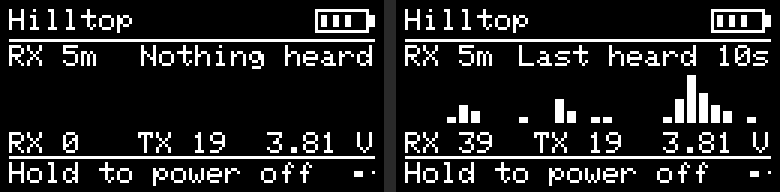
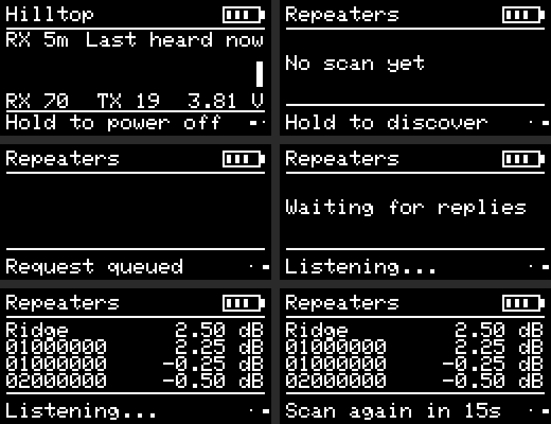

# V3 Pocket

A pocket-sized status display for a MeshCore repeater running on the **Heltec WiFi LoRa 32 V3** (ESP32-S3, SX1262, 128 × 64 SSD1306 OLED). Home shows recent packet activity, last heard, RX/TX totals and battery voltage. The PRG button opens a nearby repeater list. The firmware uses the identity and radio settings already stored on the node.

## The packet graph



The graph covers five minutes in ten-second columns, with the newest interval on the right. Each bar counts packets received while Home was visible. It samples the radio’s existing RX total once per visible refresh. A blank interval can mean silence or time away from Home. If traffic arrived during that gap, the display shows “Last RX --” until it observes another packet. Sleeping the display stops all graph work.

Home and the battery icon share a rolling eight-sample voltage reading. The filter drops the highest and lowest readings once it has five samples. The screen uses dim OLED contrast and sleeps after 30 seconds of inactivity.

## Buttons and nearby repeaters

| From | Tap PRG | Hold PRG for one second |
| --- | --- | --- |
| Screen asleep | Wake to Home | Wake to Home |
| Home | Open Repeaters | Power off |
| Repeaters | Return to Home | Send one direct discovery request |

Repeaters initially shows recent direct repeater adverts. A scan first shows the queued request, then listens for 15 seconds after confirmed transmission. The four strongest replies appear in order of received SNR, alongside a known name or a short public key. The display stays lit through the scan and gives you 30 seconds to read the results. Reset keeps its hardware function.



## Install an update

Download the application `.bin` and `manifest.json` from [Releases](https://github.com/benaltair/v3-pocket/releases). Compare the file’s SHA-256 with the manifest before installation.

1. Start with a Heltec WiFi LoRa 32 V3 already running a MeshCore **repeater**, with the compatible 8 MB dual-OTA partition layout. Back up that node’s identity and settings privately.
2. In MeshCore’s repeater admin CLI, run `start ota`. Join the `MeshCore-OTA` Wi-Fi network, open the update address returned by the repeater, and select **Firmware** and the application `.bin`.
3. After reboot, check `ver`, the node name, public identity and radio settings. Tap PRG to open Repeaters. The app image is for a firmware partition. Writing it at address zero or erasing the chip would overwrite other data.

The initial release is based on MeshCore `repeater-v1.17.1`. This Pocket UI revision was tested on a physical V3. The screen previews use simulated readings. [Upstream repeater commands](https://github.com/meshcore-dev/MeshCore/blob/d92964352441e53b93e8667b802e04f6e072b39e/docs/cli_commands.md#start-an-over-the-air-ota-firmware-update)

## Build from source

Use Python 3.9+, Git and a C++11 compiler. Install PlatformIO Core in your Python environment for the firmware build. Run from this repository’s root.

```sh
python3 -m pip install platformio==6.2.0
python3 update.py --check-only
python3 update.py --out builds
```

`upstream.json` names the official release tag and commit. The script fetches that revision into a temporary directory, applies the repeater integration patch and copies the Pocket headers from `src/`. It runs tests against the production page, button, discovery and OLED contrast code, builds the ESP32-S3 application, checks its embedded version, image digest and OTA layout, and writes the application and SHA-256 manifest under `builds/`. Each build uses a new version directory. For another build of the same version, supply a fresh output directory.

To regenerate the screenshots, install Pillow and run `python3 update.py --preview --out builds/preview`. The renderer uses the OLED driver’s own bitmap font and drawing commands from the firmware tests.

## Following MeshCore repeater releases

GitHub Actions checks published [MeshCore releases](https://github.com/meshcore-dev/MeshCore/releases) daily at **09:17 UTC** and on manual dispatch. Each new stable `repeater-vX.Y.Z` release gets its own build, tests and **draft PR** proposing the exact upstream commit. A failed port also opens a draft with its test result. Previously opened or closed proposals are skipped. Only a maintainer’s merge changes the reviewed pin. Publishing a downloadable release is a separate action.

For a fork, enable Actions and allow GitHub Actions to create pull requests in repository settings. Set the optional Actions variable `V3_REVIEWER` to the GitHub login that should review proposals. The public build uses upstream board defaults. Set a new repeater’s own identity, admin access and region on the device.

The Pocket screen layout and discovery interface share conventions with [T1 Pocket](https://github.com/benaltair/t1-pocket). The overlay is MIT licensed. MeshCore and the linked board libraries retain their respective notices. [Overlay license](LICENSE) · [MeshCore license](UPSTREAM-LICENSE.txt) · [Upstream ESP32 dependencies](https://github.com/meshcore-dev/MeshCore/blob/d92964352441e53b93e8667b802e04f6e072b39e/platformio.ini)
